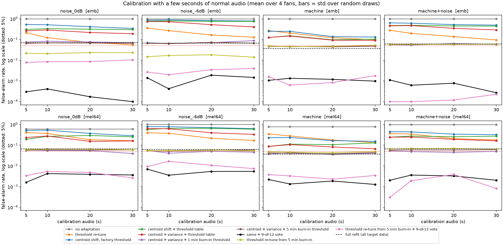

# TinyML-ESP32

**Machine sound anomaly detection on an ESP32-S3 that adapts to a new machine in seconds, without retraining.**

A small microphone device listens to a machine and raises an alarm when the sound becomes
abnormal. A frozen int8 neural network turns each second of audio into 32 numbers, and a
small calibration step in C++ learns what "normal" sounds like for the machine in front of
it from 10–30 s of audio. This is our Zhuanti project.

## The problem

An anomaly detector trained in one place does not work in another. We measured this on the
MIMII fan recordings: when the detector is moved to a fan it has never heard, or to a
noisier room, it raises an alarm on every clip (100% false alarms). Retraining the network
for every machine is not possible on a microcontroller.

## The idea

Keep the neural network fixed and adapt only a few numbers on the device.

```
microphone ──> log-mel picture ──> int8 CNN ──> 32 numbers ──> calibration ──> alarm
 16 kHz         64 x 30 per 1 s     frozen       "embedding"    + anomaly score
```

1. **Calibration (10–30 s).** The user confirms the machine is healthy. The device learns
   the average embedding of this machine and how much it varies.
2. **Burn-in (1–5 min).** The device keeps listening, raises no alarm, and sets its own
   alarm threshold from the scores it sees. A few seconds cannot show how much a noisy room
   changes from minute to minute; this step can.
3. **Monitoring.** Every 10 s clip gets an anomaly score. The alarm goes off only when 9 of
   the last 12 clips (2 minutes) are above the threshold, because noise comes and goes but a
   fault stays.

The anomaly score is a diagonal Mahalanobis distance (32 means, 32 variances, no matrix
inverse), so the whole calibration state is 448 bytes.

## Results

All numbers are from the MIMII fan data (four fans; normal and faulty recordings; three
noise levels: 6 dB quiet, 0 dB, −6 dB very noisy), mean over the four fans.

**The network** has 62,832 parameters. As an int8 TFLite model it is 72 kB and gives the
same results as the float model within 0.01. Separating normal from faulty clips when the
machine and room are known (ROC-AUC; 1.0 is perfect, 0.5 is guessing):

| noise level | ROC-AUC |
|---|---|
| 6 dB | 0.993 |
| 0 dB | 0.912 |
| −6 dB | 0.701 |

**Calibration.** The detector is moved to a new situation and calibrated with 30 s of
normal audio, a 5 min burn-in and the 9-of-12 vote:

| new situation | false alarms, no adaptation | false alarms, calibrated | faults detected |
|---|---|---|---|
| noisier room (0 dB) | 100% | 0.00% | 75% |
| very noisy room (−6 dB) | 100% | 0.15% | 20% |
| unseen fan | 100% | 0.10% | 77% |
| unseen fan + noise (0 dB) | 100% | 0.03% | 59% |

Calibration is also better than only moving the alarm threshold with the same audio
(balanced accuracy 0.87 vs 0.74, 0.88 vs 0.67 and 0.80 vs 0.70); at −6 dB the two are equal
(0.60 vs 0.61).



**On-device code.** Both C++ parts are checked against the Python reference on a PC:

| part | memory | check against Python |
|---|---|---|
| log-mel front end (`firmware/lib/zt_logmel`) | 10 kB RAM, 8 kB flash | largest difference 0.00002 dB on 240 clips |
| calibration, burn-in, vote (`firmware/lib/zt_calib`) | 448 bytes | 0 of 424,800 alarm decisions differ |

Neither uses dynamic memory or an ESP-specific library.

## Status

| step | state |
|---|---|
| Data, features, fixed audio settings | done |
| Small CNN and anomaly score | done |
| Domain shift measured (noise, unseen machine) | done |
| Calibration, burn-in, vote (Python) | done |
| int8 TFLite model | done |
| C++ log-mel and C++ calibration, tested on PC | done |
| ESP32-S3 firmware (INMP441 microphone, TFLite Micro) | not started |
| Test on a real fan | not started |
| MIMII DUE | later |

## Limits

- Nothing has run on the ESP32-S3 yet; speed and memory on the board are estimates.
- In a very noisy room (−6 dB) only about 20% of faults are detected. This is a limit of
  the network, not of the calibration.
- The false-alarm numbers are optimistic: the vote rule was chosen on the test clips, and
  MIMII clips are independent of each other, while real noise lasts longer than one clip.
- The burn-in uses 1–5 minutes of audio that nobody verified; it assumes the machine stays
  healthy during that time.
- An alarm needs at least 90 s of fault sound.
- Only fans, and only four of them. In the two "noisier room" cases the network had seen
  that fan (and 0 dB noise) during training; −6 dB and the unseen fans are truly new.

Details, decisions and all tables are in [notes.md](notes.md).

## Repository

```
src/         Python: features, training, evaluation, calibration experiments, C++ tests
firmware/    C++ for the ESP32-S3
  lib/zt_logmel/   audio -> int8 model input
  lib/zt_calib/    calibration, burn-in, vote
  test_pc/         test programs built with g++ on the PC
results/     figures and tables
notes.md     settings, decisions, results week by week
data/        MIMII recordings (not in git)
models/      trained models (not in git)
```

## Reproduce

### Setup (once per person)
Needs Python 3.11.

Windows (PowerShell):
```
py -3.11 -m venv venv
venv\Scripts\Activate.ps1
pip install -r requirements.txt
```
macOS / Linux:
```
python3.11 -m venv venv
source venv/bin/activate
pip install -r requirements.txt
```
In VS Code: Ctrl+Shift+P → "Python: Select Interpreter" → pick `venv`.

### Data (not in git)
Download from MIMII (https://zenodo.org/record/3384388): `6_dB_fan.zip`, `0_dB_fan.zip`,
`-6_dB_fan.zip`. Each zip contains a `fan/` folder. Unzip each into its own noise-level folder:

```
data/6dB/fan/id_00/{normal,abnormal}/*.wav
data/0dB/fan/...
data/-6dB/fan/...
```
Windows: `Expand-Archive 6_dB_fan.zip -DestinationPath data\6dB` (same for the others).
macOS/Linux: `unzip 6_dB_fan.zip -d data/6dB`.

```
python src/check_data.py                  # checks the folders and files
python src/cache_features.py --snr 6dB    # once per noise level, ~1 min, ~400 MB in data/cache
python src/cache_features.py --snr 0dB
python src/cache_features.py --snr=-6dB   # "=" needed: argparse reads a bare -6dB as a flag
python src/explore.py --snr 6dB           # optional: spectrogram plots in results/
```

### Train the network
```
python src/train.py --name fan_v1 --snrs 6dB 0dB --classes id_snr --mixup 0.5   # ~10 min on CPU
python src/evaluate.py --model fan_v1
python src/evaluate.py --model fan_v1 --conditions="6dB>6dB,6dB>-6dB"   # fit>test pairs
```
For the unseen-fan tests, one network per left-out fan:
```
python src/train.py --name loo_id_00 --holdout-id id_00 --snrs 6dB 0dB --classes id_snr --mixup 0.5
# ...same for id_02, id_04, id_06 (one or two at a time: four at once runs out of memory)
python src/shift_machine.py     # results/shift_machine.csv
python src/plot_shift.py        # results/week3_shift.png
```

### Calibration experiment
```
python src/calib_experiment.py   # needs fan_v1 and the four loo_ models; ~3 min
```
Writes `results/calibration.csv`, `results/week4_calibration.png` and
`results/week4_false_alarms.png`. The methods are in `src/calibration.py`.

### int8 model
```
python src/convert_tflite.py --model fan_v1      # models/fan_v1_int8.tflite, ~72 kB
python src/evaluate.py --model fan_v1_int8       # same tables with the int8 embedding
python src/calib_experiment.py --suffix _int8 --tag _int8   # needs the loo_ models converted too
```

### C++ tests on the PC
Need g++ on the PATH (MinGW-w64 on Windows), the int8 models and the wav files.
```
python src/test_cpp_logmel.py      # firmware/lib/zt_logmel against features.py
python src/test_cpp_calib.py       # firmware/lib/zt_calib against calibration.py (--all for every fan)
python src/export_factory.py       # writes firmware/generated/zt_factory.h (not committed)
python src/export_logmel_tables.py # only after changing src/audio_config.py
```

## Rules
- Never commit `data/`, `venv/`, or model files (.gitignore covers them).
- Audio settings live only in `src/audio_config.py`; change them only with a note in notes.md.
